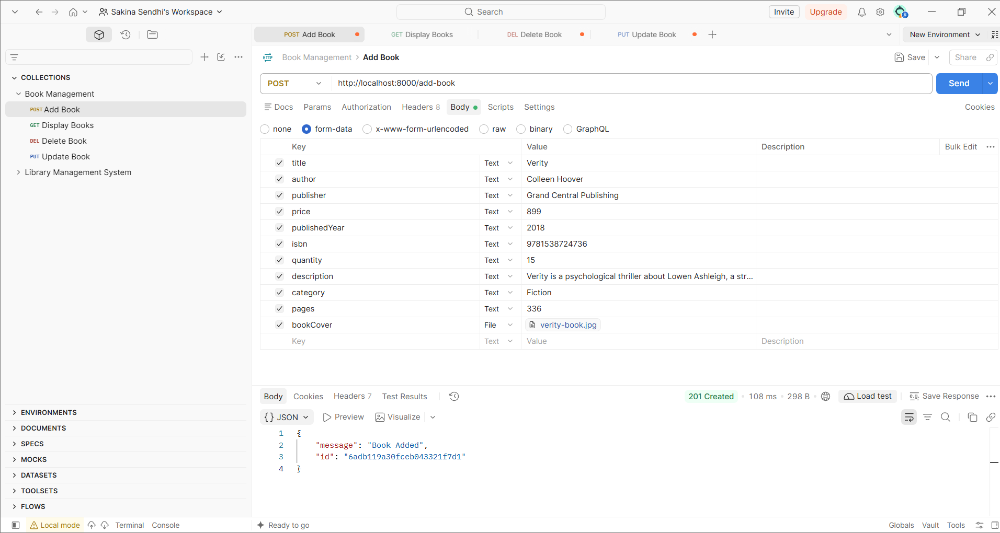
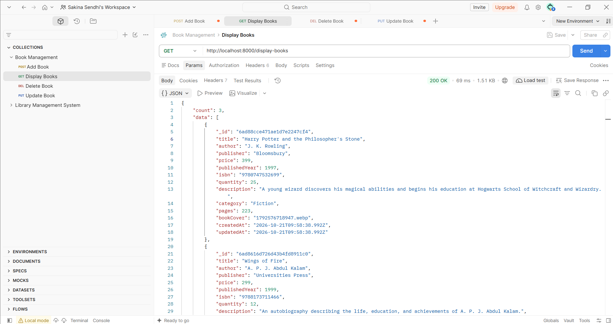
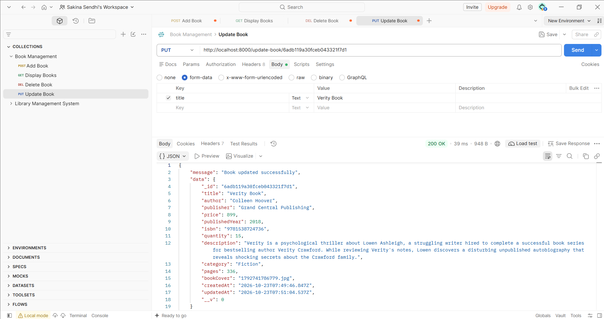
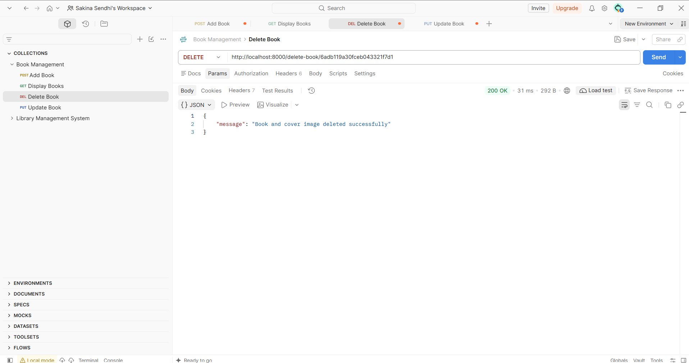
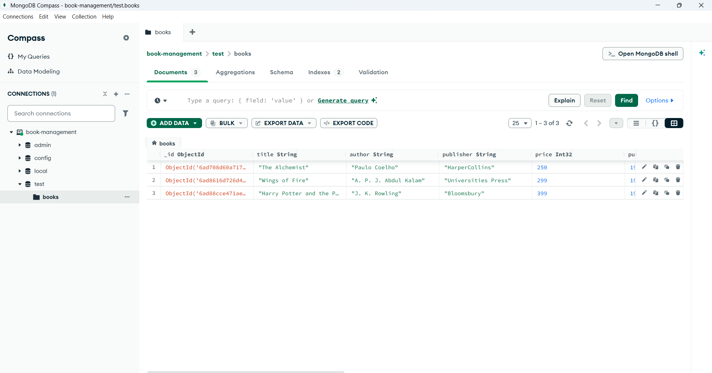

<div align="center">

# 📚 Project: Book Management System API

**A RESTful Book Management System built using Node.js, Express.js, MongoDB, and Mongoose, featuring CRUD operations, book-cover image uploads, request validation, and Postman API testing.**

</div>

---

## 📑 Table of Contents

* [Project Description](#-project-description)
* [Features](#-features)
* [Technologies Used](#-technologies-used)
* [How This Project Works](#-how-this-project-works)
* [CRUD Operations](#-crud-operations)
* [API Endpoints](#-api-endpoints)
* [Book Schema](#-book-schema)
* [Form Validation](#-form-validation)
* [Image Uploads](#-image-uploads)
* [Project Structure](#-project-structure)
* [Installation and Setup](#-installation-and-setup)
* [Environment Variables](#-environment-variables)
* [Testing with Postman](#-testing-with-postman)
* [Screenshots](#-screenshots)
* [Error Handling](#-error-handling)
* [Demo](#-demo)
* [Author](#-author)

---

## 📌 Project Description

The **Book Management System API** is a backend application developed using Node.js, Express.js, MongoDB, and Mongoose.

The application provides REST API endpoints to create, retrieve, update, and delete book records.

Each book contains information such as its title, author, publisher, price, published year, ISBN, quantity, description, category, number of pages, and book-cover image.

The project uses **Multer** to handle image uploads, **express-validator** to validate book information, and **MongoDB** to store book records.

Postman is used to test the API endpoints and verify their responses.

---

## ✨ Features

* Add a new book.
* Display all available books.
* Update existing book information.
* Delete a book from the database.
* Upload book-cover images using Multer.
* Store book information in MongoDB.
* Validate book information before adding records.
* Prevent duplicate ISBN values.
* Validate MongoDB ObjectId values for update and delete operations.
* Automatically maintain creation and update timestamps.
* Replace existing book-cover images.
* Delete cover images when deleting books.
* Serve uploaded images through Express static middleware.
* Return JSON responses with appropriate HTTP status codes.
* Test API operations using Postman.

---

## 🔧 Technologies Used

### Backend Technologies

| Technology        | Purpose                                |
| ----------------- | -------------------------------------- |
| Node.js           | JavaScript runtime environment         |
| Express.js        | REST API development                   |
| MongoDB           | NoSQL database                         |
| Mongoose          | MongoDB schema and database operations |
| Multer            | Handling file uploads                  |
| express-validator | Request data validation                |
| dotenv            | Loading environment variables          |
| fs                | File-system operations                 |
| path              | Handling file paths                    |

### Development Tools

* Postman
* npm
* Visual Studio Code

---

## 📝 How This Project Works

The application follows a simple client-server architecture.

1. A client sends an HTTP request to an Express API endpoint.
2. Express processes the request using the configured middleware.
3. Multer handles book-cover uploads when required.
4. The validation middleware checks submitted book information when adding a book.
5. Mongoose interacts with MongoDB to perform database operations.
6. Express returns a JSON response to the client.
7. Uploaded images are saved in the `uploads/` directory and served through the `/uploads` route.

---

## 🔄 CRUD Operations

The application supports all four major CRUD operations.

| Operation | HTTP Method | Endpoint           | Description             |
| --------- | ----------- | ------------------ | ----------------------- |
| Create    | POST        | `/add-book`        | Add a new book          |
| Read      | GET         | `/display-books`   | Retrieve all books      |
| Update    | PUT         | `/update-book/:id` | Update an existing book |
| Delete    | DELETE      | `/delete-book/:id` | Delete a book           |

---

## 🌐 API Endpoints

The examples below use `http://localhost:3000` as the base URL. Replace `3000` with the port configured in your `.env` file if necessary.

### 1. Add Book

**Endpoint**

`POST /add-book`

**Full URL**

`http://localhost:3000/add-book`

This endpoint adds a new book to the MongoDB database.

Select **Body → form-data** in Postman.

| Field           | Type | Required | Description                       |
| --------------- | ---- | -------- | --------------------------------- |
| `title`         | Text | Yes      | Book title                        |
| `author`        | Text | Yes      | Author name                       |
| `publisher`     | Text | Yes      | Publisher name                    |
| `price`         | Text | Yes      | Book price                        |
| `publishedYear` | Text | Yes      | Year of publication               |
| `isbn`          | Text | Yes      | ISBN-10 or ISBN-13                |
| `quantity`      | Text | No       | Available quantity; defaults to 1 |
| `description`   | Text | Yes      | Book description                  |
| `category`      | Text | Yes      | Book category                     |
| `pages`         | Text | Yes      | Number of pages                   |
| `bookCover`     | File | Yes      | Book-cover image                  |

**Example success response**

HTTP status: `201 Created`

```json
{
  "message": "Book Added",
  "id": "YOUR_CREATED_BOOK_ID"
}
```

The response contains the ID of the newly created book.

If the ISBN already exists, the API returns `409 Conflict`.

### 2. Display Books

**Endpoint**

`GET /display-books`

**Full URL**

`http://localhost:3000/display-books`

This endpoint retrieves all books stored in MongoDB.

The results are sorted by `createdAt` in descending order, so the newest records appear first.

The `__v` field is excluded from the response.

**Example response**

```json
{
  "count": 1,
  "data": [
    {
      "_id": "YOUR_BOOK_ID",
      "title": "Example Book",
      "author": "Example Author",
      "publisher": "Example Publisher",
      "price": 250,
      "publishedYear": 2024,
      "isbn": "9781234567890",
      "quantity": 1,
      "description": "An example book description.",
      "category": "Technology",
      "pages": 250,
      "bookCover": "1720000000000.jpg",
      "createdAt": "2026-01-01T00:00:00.000Z",
      "updatedAt": "2026-01-01T00:00:00.000Z"
    }
  ]
}
```

*Note: The example data is illustrative. Your actual response depends on the records stored in MongoDB.*

### 3. Update Book

**Endpoint**

`PUT /update-book/:id`

**Example URL**

`http://localhost:3000/update-book/YOUR_BOOK_ID`

This endpoint updates an existing book using its MongoDB ObjectId.

The request can update individual fields without requiring every book field to be submitted.

To replace the cover image, include `bookCover` as a file in the Postman `form-data` body. If no new image is uploaded, the existing cover is retained.

When a new cover is uploaded, the application saves the updated book before attempting to remove the previous cover image.

**Example response**

```json
{
  "message": "Book updated successfully",
  "data": {
    "_id": "YOUR_BOOK_ID",
    "title": "Updated Book Title"
  }
}
```

The `data` field contains the saved book document. The example above is abbreviated.

### 4. Delete Book

**Endpoint**

`DELETE /delete-book/:id`

**Example URL**

`http://localhost:3000/delete-book/YOUR_BOOK_ID`

This endpoint deletes a book from MongoDB.

The application:

1. Validates the MongoDB ObjectId.
2. Checks whether the book exists.
3. Attempts to delete the associated cover image.
4. Deletes the book record from MongoDB.
5. Returns a JSON response.

**Example response**

```json
{
  "message": "Book and cover image deleted successfully"
}
```

If the book has no cover image, the API returns:

```json
{
  "message": "Book deleted successfully"
}
```

---

## 📚 Book Schema

The Mongoose schema is defined in `models/Book.js`.

| Field           | Data Type | Validation                                 |
| --------------- | --------- | ------------------------------------------ |
| `title`         | String    | Required, trimmed                          |
| `author`        | String    | Required, trimmed                          |
| `publisher`     | String    | Required                                   |
| `price`         | Number    | Required, minimum 0                        |
| `publishedYear` | Number    | Required                                   |
| `isbn`          | String    | Required, unique                           |
| `quantity`      | Number    | Required, minimum 0, default 1             |
| `description`   | String    | Required                                   |
| `category`      | String    | Required, restricted to allowed categories |
| `pages`         | Number    | Required, minimum 0                        |
| `bookCover`     | String    | Required                                   |
| `createdAt`     | Date      | Automatically generated                    |
| `updatedAt`     | Date      | Automatically updated                      |

The schema uses Mongoose timestamps:

```javascript
{
    timestamps: true
}
```

This automatically maintains the `createdAt` and `updatedAt` fields.

### Supported Book Categories

The application supports the following categories:

* Novel
* Education
* Technology
* History
* Biography
* Fiction

---

## 📝 Form Validation

The project uses `express-validator` to validate book information when adding a new book.

### Validation Rules

| Field          | Validation                                                           |
| -------------- | -------------------------------------------------------------------- |
| Title          | Required; maximum 200 characters                                     |
| Author         | Required; maximum 100 characters                                     |
| Publisher      | Required                                                             |
| Price          | Required; numeric value greater than or equal to 0                   |
| Published Year | Required; integer between 1 and the current year                     |
| ISBN           | Required; must match the configured ISBN-10 or ISBN-13 format        |
| Quantity       | Optional in the request; if provided, must be a non-negative integer |
| Description    | Required                                                             |
| Category       | Must match one of the six supported categories                       |
| Pages          | Required; positive integer                                           |
| Book Cover     | Required for adding a book                                           |

If validation fails, the API returns `400 Bad Request`.

**Example validation response**

```json
{
  "message": "Validation failed",
  "errors": [
    {
      "field": "title",
      "message": "Title is required."
    }
  ]
}
```

The error response contains the field name and its corresponding validation message.

The configured ISBN rule checks the format of the ISBN but does not verify its checksum digits.

**Note:** The `bookRules` middleware is applied to the add-book endpoint. The update endpoint does not use these express-validator rules, although Mongoose schema validation runs when the document is saved.

---

## 📂 Image Uploads

The project uses **Multer** to upload book-cover images.

### Image Storage

Uploaded images are stored in:

```text
uploads/
```

Multer generates filenames using the current timestamp and the original file extension.

For example:

```text
1720000000000.jpg
```

The generated filename is stored in the `bookCover` field in MongoDB.

### Accessing Uploaded Images

The application serves the uploads directory through Express static middleware:

```javascript
app.use("/uploads", express.static(path.join(__dirname, "uploads")));
```

A cover image can therefore be accessed using a URL such as:

```text
http://localhost:3000/uploads/1720000000000.jpg
```

Replace the example filename with the actual filename stored in your database.

The current Multer configuration does not specify file-size or file-type restrictions. These should be added before deploying the application to production.

---

## 📂 Project Structure

```text
book-management-system/
│
├── .postman/
│
├── models/
│   └── Book.js
│
├── node_modules/
│
├── output/
│   ├── addBook.png
│   ├── deleteBook.png
│   ├── displayBook.png
│   ├── mongoDB.png
│   └── updateBook.png
│
├── postman/
│
├── uploads/
│   └── Book cover images
│
├── .env
├── app.js
├── package.json
├── package-lock.json
└── README.md
```

### Important Files and Folders

* **`app.js`** — Configures Express, connects to MongoDB, defines middleware, and implements the API routes.
* **`models/Book.js`** — Defines the Mongoose book schema and its validation rules.
* **`uploads/`** — Stores uploaded book-cover images.
* **`output/`** — Contains screenshots of API operations and the MongoDB database.
* **`.env`** — Stores environment variables such as the port and MongoDB connection URI.
* **`package.json`** — Contains project metadata, dependencies, and any configured npm scripts.
* **`postman/`** — Project folder for Postman-related files, if present.

---

## 🚀 Installation and Setup

### Prerequisites

Install the following tools before running the project:

* Node.js
* npm
* MongoDB
* Postman (for API testing)

### Step 1: Open the Project

Open the project directory in Visual Studio Code or your preferred editor.

### Step 2: Install Dependencies

Run:

```bash
npm install
```

If the dependencies are not already listed in `package.json`, install the packages used by the application:

```bash
npm install express mongoose multer dotenv express-validator
```

### Step 3: Configure Environment Variables

Create or update the `.env` file in the project root.

```env
PORT=3000
MONGO_URI=mongodb://127.0.0.1:27017/bookManagement
```

These are example values. Use your own MongoDB connection URI and an available port.

### Step 4: Ensure the Upload Directory Exists

Make sure the `uploads/` directory exists before submitting requests that upload images.

### Step 5: Start the Application

If your `package.json` contains a suitable start script, run:

```bash
npm start
```

Otherwise, start the server directly:

```bash
node app.js
```

The server uses the `PORT` environment variable.

When the database connection succeeds, the application logs:

```text
Connected Successfully!
```

The server also logs its local URL when it starts.

---

## 🔐 Environment Variables

The application uses `dotenv` to read environment variables from `.env`.

| Variable    | Purpose                         | Example                                    |
| ----------- | ------------------------------- | ------------------------------------------ |
| `PORT`      | Port used by the Express server | `3000`                                     |
| `MONGO_URI` | MongoDB connection URI          | `mongodb://127.0.0.1:27017/bookManagement` |

---

## 🧪 Testing with Postman

Postman can be used to test all four CRUD operations.

### Add Book

1. Create a new request.
2. Select `POST`.
3. Enter `http://localhost:3000/add-book`.
4. Select **Body → form-data**.
5. Add the required book fields.
6. Set `bookCover` to the **File** type and select an image.
7. Send the request and inspect the response.

### Display Books

1. Create a new request.
2. Select `GET`.
3. Enter `http://localhost:3000/display-books`.
4. Send the request.
5. Inspect the returned book records.

### Update Book

1. Copy a book's `_id` from the display-books response.
2. Select `PUT`.
3. Enter `http://localhost:3000/update-book/YOUR_BOOK_ID`.
4. Submit the fields you want to update using `form-data`.
5. Include a new `bookCover` file only if you want to replace the existing cover.
6. Send the request and verify the updated record.

### Delete Book

1. Copy the `_id` of the book you want to delete.
2. Select `DELETE`.
3. Enter `http://localhost:3000/delete-book/YOUR_BOOK_ID`.
4. Send the request.
5. Verify the response and check that the book is no longer returned by the display-books endpoint.

---

## 📸 Screenshots

The following screenshots are available in the project's `output/` folder.

### ➕ Add Book



### 📚 Display Books



### ✏️ Update Book



### 🗑️ Delete Book



### 🍃 MongoDB Database



---

## 🔄 Error Handling

The API returns JSON responses for successful operations and common errors.

| HTTP Status                 | Meaning                                               |
| --------------------------- | ----------------------------------------------------- |
| `200 OK`                    | Request completed successfully                        |
| `201 Created`               | Book created successfully                             |
| `400 Bad Request`           | Invalid book ID, missing cover, or validation failure |
| `404 Not Found`             | Book not found                                        |
| `409 Conflict`              | ISBN already exists                                   |
| `500 Internal Server Error` | Database or server operation failed                   |

The application uses `try...catch` blocks to handle errors during database operations and returns an appropriate response to the client.

---

## 🎬 Demo

|                        |                                    |
| ---------------------- | ---------------------------------- |
| 💻 Project Video | [Blog Website Recording](https://drive.google.com/file/d/1eCjIPuZbv4TaAToJyPmWJZUgWiXq4hhH/view?usp=sharing)    |
| 🎥 Project Explanation | [Blog Website Explanation](https://drive.google.com/file/d/1J8ZybwAQ_ITJRvAhLHb8nEfHDFpK6y79/view?usp=sharing) |

---

## 💻 Author

<div align="center">

**Sakina Mufaddal Sendhi**

[](https://github.com/sakinasendhi52)

⭐ Thank you for visiting this repository!

</div>
